# Azure Functions C# Isolated Worker App via Command Line Interface

---

## 1. Architecture & Provisioned Resources

### Core Infrastructure Topology

| Resource Type | Resource Name | Specification / Purpose | Region / Location |
| :--- | :--- | :--- | :--- |
| **Azure Function App** | `azurefunctiontestapp13` | Serverless Function App running .NET 8 Isolated Worker runtime | East US |
| **App Service Plan** | `EastUSPlan` | Consumption Plan (Y1 Dynamic Tier) providing elastic compute | East US |
| **Storage Account** | `strfunctiontest13` | General Purpose V2 storage (`Standard_LRS`) for Function execution logs & keys | East US |
| **HTTP Trigger Function** | `HttpExample` | Anonymous-level HTTP endpoint handling GET and POST requests | Isolated .NET Worker |

---

### Provisioned Environment Validation

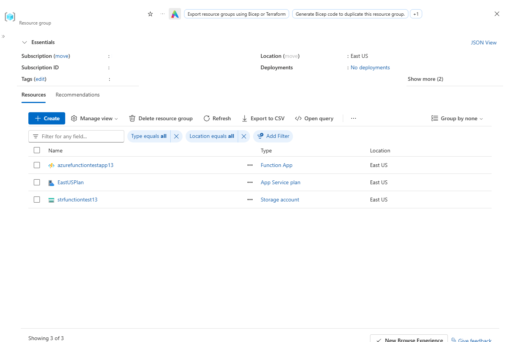

*Resource group inventory confirming successful deployment of Azure Function App, App Service Plan, and Storage Account.*

---

## 2. Step-by-Step Implementation

### Step 1: Initialize Local Azure Function Project

1. Navigated to the root directory and initialized a local C# Function project using Azure Functions Core Tools.
2. Specified the worker runtime as `dotnet-isolated` targeting the `.NET 8.0` framework.

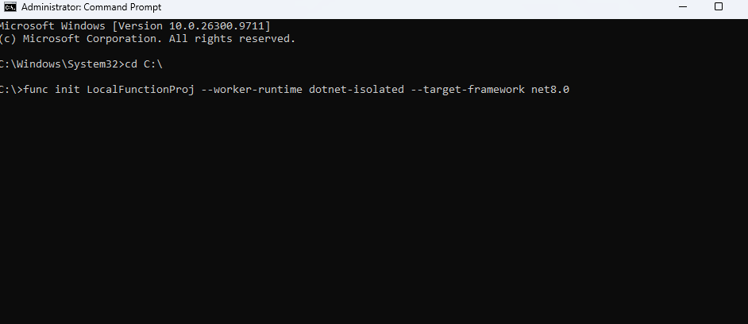

*Command prompt output verifying project initialization using func init LocalFunctionProj with .NET 8 isolated worker framework.*

---

### Step 2: Create HTTP Trigger Function

1. Created a new HTTP-triggered C# function named `HttpExample` inside the local project.
2. Configured the authentication level to `anonymous` for public endpoint access.

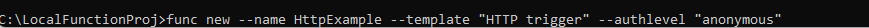

*Command output illustrating the execution of func new to generate the HTTP-triggered function template.*

---

### Step 3: Provision Azure Storage Account

1. Provisioned a new Azure Storage Account (`strfunctiontest13`) using Azure CLI with standard locally redundant storage (`Standard_LRS`).
2. Configured security rules with `allow-blob-public-access false` to enforce security best practices.

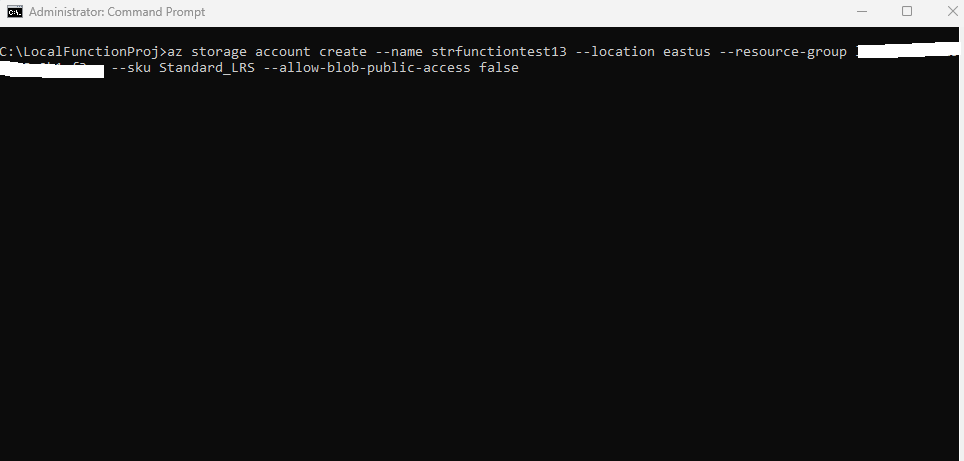

*Azure CLI command creating the supporting storage account for function app state management.*

---

### Step 4: Provision Azure Function App

1. Executed Azure CLI command `az functionapp create` to provision the serverless hosting environment.
2. Configured consumption hosting in region `eastus` with runtime `dotnet-isolated` version 4.

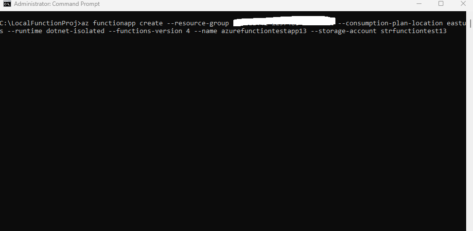

*Azure CLI command execution provisioning the Function App bound to the created storage account and consumption plan.*

---

### Step 5: Local Execution and Testing

1. Started the local Functions host runtime using `func start` to compile and launch the project.
2. Verified local endpoint execution by requesting `http://localhost:7071/api/HttpExample`.

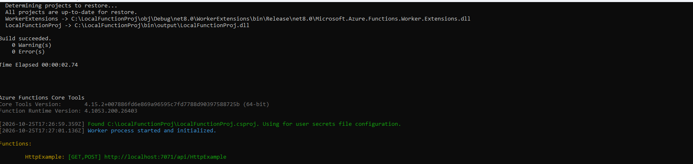

*Local Functions host output confirming successful build and registering local URL endpoint http://localhost:7071/api/HttpExample.*

---

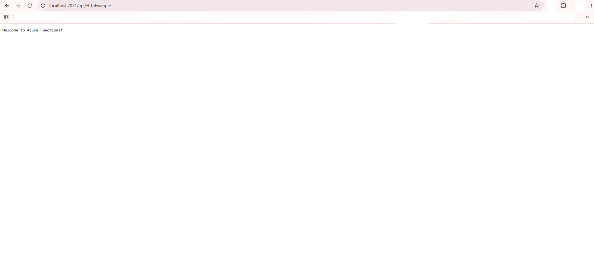

*Web browser verifying successful execution of local function endpoint returning the welcome message.*

---

### Step 6: Deploy Project to Azure

1. Published the local C# project directly to Azure using `func azure functionapp publish`.
2. Automated compilation, zip deployment, and remote trigger syncing.

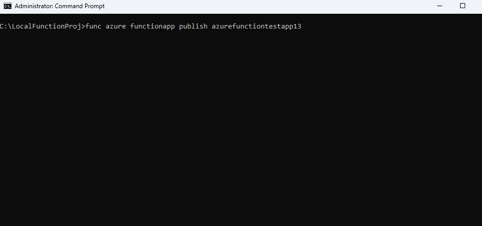

*Execution of func azure functionapp publish azurefunctiontestapp13 pushing local binaries to Azure.*

---

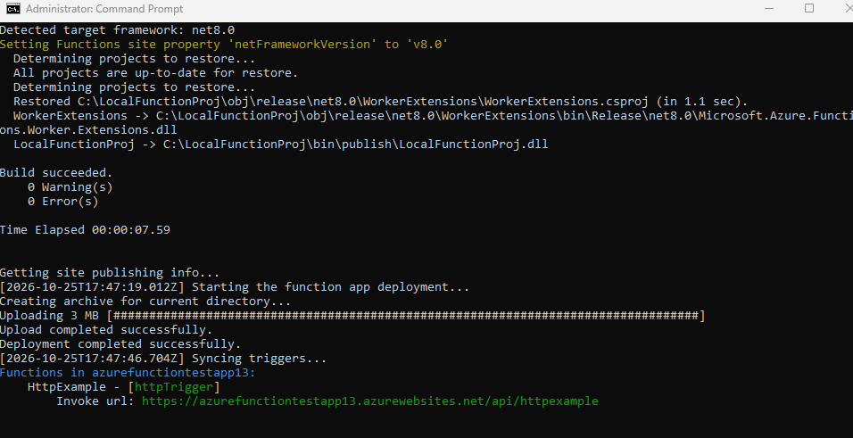

*Build success and deployment summary confirming active invoke URL https://azurefunctiontestapp13.azurewebsites.net/api/httpexample.*

---

## 3. Verification & Monitoring

### Endpoint Validation

1. Verified the deployed function app directly in Azure to confirm its status and deployed HTTP trigger.
2. Initiated live log streaming using `func azure functionapp logstream` to monitor application events.

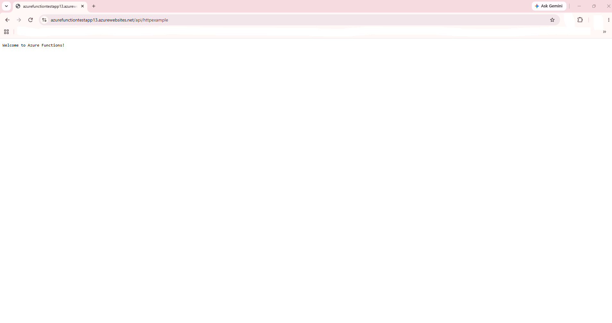

*Azure Portal overview confirming the active HTTP trigger function inside the deployed Function App.*

---

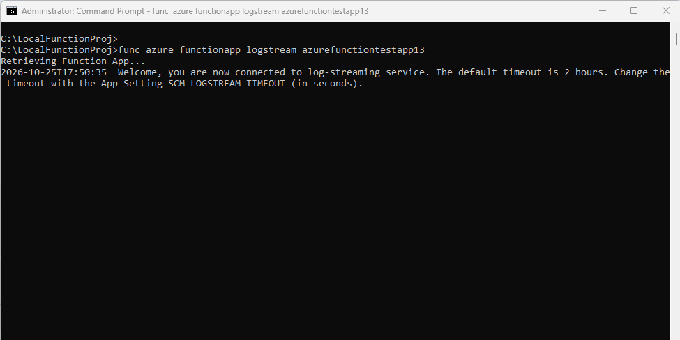

*Command output showing active connection to Azure Function App real-time log-streaming service.*
